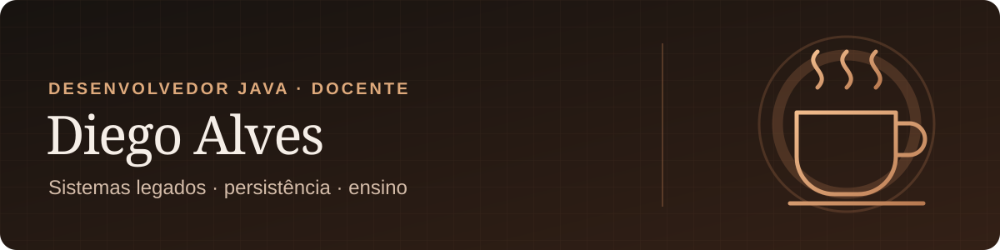

  

  <a href="https://www.linkedin.com/in/diego-h-alves-dev/">LinkedIn</a> ·
  <a href="https://github.com/DiegoAlvesDevCuiabano?tab=repositories">Repositórios</a>

Sou desenvolvedor Java e docente do Centro Universitário SENAI Mato Grosso. Trabalho na evolução de aplicações grandes e legadas, com atenção ao caminho entre a requisição, o código e o banco de dados.

## Livro em escrita

### Desconstruindo um Banco de Dados

Uma leitura sobre o caminho de uma consulta: do objeto Java ao bloco de dados e de volta. O manuscrito está em desenvolvimento, com cinco capítulos escritos de um plano de 14. A versão completa ainda não foi publicada.

## Projetos selecionados

| Produto e demonstrações | O que você encontra |
| :--- | :--- |
| **[Delibera](https://github.com/DiegoAlvesDevCuiabano/Delibera)** | Sistema de gestão de solicitações acadêmicas em Java e Spring Boot. Em desenvolvimento; ainda não pronto para dados reais. |
| **[Delibera Demo](https://diegoalvesdevcuiabano.github.io/Delibera-Demo/)** | Protótipo navegável do fluxo do produto. |
| **[CPA Demo](https://diegoalvesdevcuiabano.github.io/CPA-Demo/)** | Protótipo de interface para avaliação institucional, sem backend público. |

| Engenharia e experimentos | O que você encontra |
| :--- | :--- |
| **[DecafDB](https://github.com/DiegoAlvesDevCuiabano/DecafDB)** | Motor didático de banco de dados feito em Java. Experimento em desenvolvimento. |
| **[Laboratório de persistência](https://github.com/DiegoAlvesDevCuiabano/data-persistence-engineering-lab)** | Exemplos e análises sobre acesso a dados, ORM e decisões de persistência em Java. |

---

Java · aplicações legadas · persistência · docência

